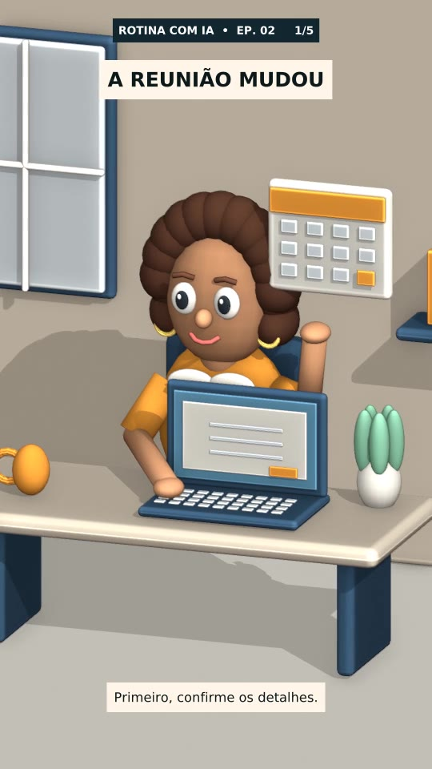

# Vídeos da Lia

Repositório para guardar vídeos e roteiros de Administração com IA na Prática.

## Episódio 02 — A reunião mudou — versão 3D

- [Baixar animação 3D em MP4](https://github.com/andersonx553-beep/skills.projects/raw/refs/heads/main/videos/lia-ep02-3d-sem-voz.mp4)
- [Roteiro e falas da versão 3D](roteiros/lia-ep02-3d.txt)

Animação 3D feita em Blender, com personagem feminina, movimentos de cabeça e braços, calendário animado, digitação, revisão e envio de e-mail. Formato vertical, 540 × 960, 24 fps, 30 segundos, sem áudio.

## Versão ilustrada 2D

- [Baixar o vídeo MP4](https://github.com/andersonx553-beep/skills.projects/raw/refs/heads/main/videos/lia-ep02-sem-voz.mp4)
- [Ver roteiro e falas](roteiros/lia-ep02.txt)

Vídeo vertical, 720 × 1280, 30 segundos, sem áudio. Ilustrações 2D com movimentos de câmera e elementos gráficos animados.

## Organização

- `videos/`: vídeos finais em MP4.
- `roteiros/`: roteiros e falas para gravação.

Os arquivos anteriores foram removidos da versão atual; continuam disponíveis no histórico do Git.
